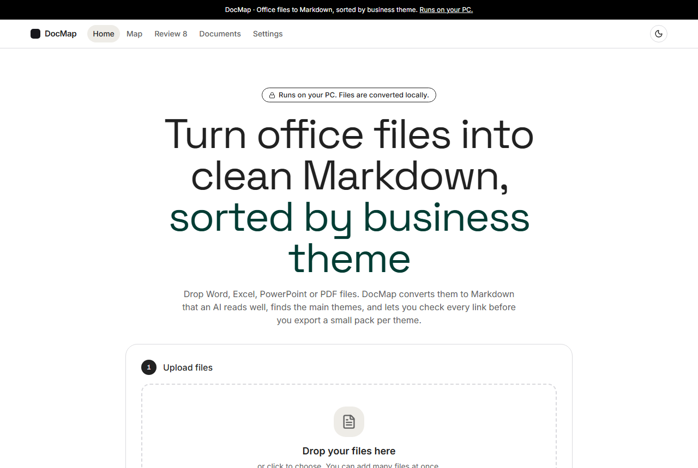
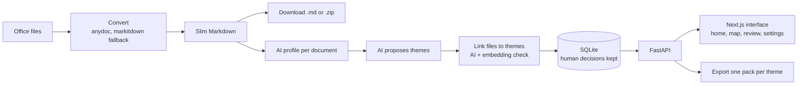

# DocMap

DocMap turns a folder of office files into clean Markdown and sorts the files by business theme. You drop in Word, Excel, PowerPoint and PDF files. DocMap converts each one to Markdown, an AI model reads them and proposes the main themes of the business, and you check every link between a file and a theme before you use it.



A two-minute video of a real run, from an empty library to exported theme packs, is in [docs/demo-v2.mp4](docs/demo-v2.mp4). The AI step in the video ran live and is shown at 12x speed.

The answers to the assessment questions (AI tools, technical explanation, challenges) are in [SUBMISSION.md](SUBMISSION.md).

## Why we built it

People paste whole reports, spreadsheets and slide decks into AI chats. That costs tokens, and the model has to dig through layout noise to find the content. We wanted three things:

1. Give the model Markdown instead of the original files, so tables stay tables and headings stay headings.
2. Group the documents by business theme, so you can send the model only the files that matter for one question.
3. Keep a person in charge of the grouping, with a screen that makes checking and correcting the links quick.

## What the app does

- Converts PDF, Word, Excel, PowerPoint, CSV, OpenDocument, RTF and EPUB files to Markdown on your PC. Conversion uses no AI model.
- Keeps every row of every spreadsheet. When a file is too large for most AI models, DocMap warns you instead of cutting it.
- Flags scanned PDF pages that have no text layer, so you know they need OCR.
- Finds 4 to 7 business themes across your files and links each file to its themes, with a confidence score and the passages that support each link.
- Shows the links on a map and in a review queue that puts the least certain links first. You accept, reject or move each one, and a later AI run never overwrites your decision.
- Lets you download each Markdown file, all of them as a zip, or one Markdown pack per theme.

## How to run it

You need Windows, Python 3.12 or newer with [uv](https://docs.astral.sh/uv/), and Node.js.

1. Double-click `Start DocMap.bat`. The first start installs the packages and builds the interface, which takes a few minutes. Later starts take a few seconds. The browser opens http://localhost:3000 when the app is ready.
2. Drop files into the upload area, or click "Try the 22 sample files".
3. Click "Convert to Markdown" for Markdown only, or "Convert and find themes" to have the AI group the files.
4. To stop the app, double-click `Stop DocMap.bat`.

The theme step needs an AI model. Open Settings in the app and choose one of the two options below. Conversion works without either.

### Why NVIDIA NIM or Ollama

NVIDIA NIM stands in for the kind of paid, hosted AI service a company would use in production. It is an OpenAI-compatible API, so the same code would work with other hosted providers. NVIDIA gives free API keys, which made it possible to test against a real cloud model at no cost. To use it, get a key at [build.nvidia.com](https://build.nvidia.com) and paste it into Settings. The app saves it in `backend\.env` and tests it with one small request.

Ollama runs the models on your own PC. Nothing leaves the machine, which matters for confidential company documents, and it costs nothing to run. To use it, install Ollama from [ollama.com/download](https://ollama.com/download) and run:

```powershell
ollama pull gemma3:4b
ollama pull nomic-embed-text
```

The first model writes the document summaries and theme names (about 3.3 GB). The second compares texts (about 0.3 GB). Settings shows a green status when both are installed.

### Starting on Windows: from PowerShell windows to one double-click

The first version started with a PowerShell script, `run.ps1`. It had two problems. Double-clicking it made Windows ask which program should open the file, because Windows does not run `.ps1` files by default. When it did run (with `powershell -ExecutionPolicy Bypass -File .\run.ps1`), it opened two extra PowerShell windows, one for the API and one for the interface, and both had to stay open.

`Start DocMap.bat` fixes both. A `.bat` file runs on a double-click. It calls `scripts\start.ps1` with the execution policy set for that one call, and that script starts the API and the interface as hidden background processes. It writes their output to `data\logs\`, waits until both answer, and opens the browser. The small start window then closes, and the app keeps running. `Stop DocMap.bat` finds the two processes by their ports and stops them. The script also rebuilds the interface only when its source code has changed, so a normal start is fast.

## What the tests say about tokens

Token counts use the `o200k_base` tokenizer and two test sets of UK public-sector files: 22 files from the Environment Agency and Defra (included in `corpus/raw`), and 19 files from the Food Standards Agency that were kept apart and never used while building the method.

| Comparison | Result |
|---|---|
| One theme's pack against the whole library | at least 98% fewer tokens for 4 of the 5 themes |
| Markdown against uploading the original files | 71.5% fewer tokens (Food Standards Agency set; the upload cost is an estimate based on page images) |
| Markdown against a plain-text copy of the same files | 6.6% fewer on the main set and 10% fewer on the second set; 56% fewer on the main set without its one 12 MB spreadsheet |
| Optional spreadsheet summary at export | 98.4% fewer tokens on the main set (keeps statistics and the first 20 rows of large sheets; off by default) |

Markdown alone is close in size to plain text. It adds headings and table marks that plain text leaves out, and that structure is what helps a model read the content. The large saving comes from routing: when you ask about one theme, you send that theme's pack and leave the rest of the library out. One theme pack stayed large because it holds a spreadsheet with 8 million tokens, and the app shows a warning for it.

The themes were also checked against labels a person set by hand. On the Food Standards Agency files, which were never used during development, the AI's themes scored an F1 of 0.93. On the main set with the file names hidden, so that names like `fin-01` gave no hints, it scored 0.72. AI answers vary from run to run, which is why every link goes through human review.

## How it works



Each file goes through [anydoc](https://github.com/firecrawl/anydoc) first and [markitdown](https://github.com/microsoft/markitdown) if anydoc cannot read it. A slim pass removes image links, empty cells and repeated headers. For the theme step, the model writes a two-sentence business summary of each document, proposes themes for the whole set in one call, and then assigns each file to its themes. An embedding similarity check runs next to the model's answer, and links where the two disagree go to the top of the review queue. Document text is wrapped in `<document>` tags, so text inside a file is not read as an instruction.

The backend is Python 3.12 with FastAPI, SQLModel on SQLite, anydoc, markitdown, openpyxl, tiktoken and NumPy. The interface is Next.js 16 with React 19, TypeScript, Tailwind CSS v4, shadcn/ui, kokonutui components and React Flow for the map. The visual style follows Cohere's design system as published in [awesome-design-md](https://github.com/VoltAgent/awesome-design-md). More detail is in [docs/architecture.md](docs/architecture.md).

| Folder or file | What it holds |
|---|---|
| `backend/docmap/convert.py`, `slim.py`, `digest.py` | conversion, token slimming, optional spreadsheet summary |
| `backend/docmap/llm.py` | one client per model role, the NIM and Ollama presets, retries and caches |
| `backend/docmap/profile.py`, `induce.py`, `link.py` | document summaries, theme finding, file-to-theme links |
| `backend/docmap/store.py` | the SQLite store; links set by a person are never overwritten |
| `backend/docmap/pipeline.py`, `eval.py`, `export.py` | the full run, the scoring against hand labels, the theme packs |
| `backend/docmap/api.py` | the HTTP API used by the interface |
| `frontend/app/` | the pages: home, map, review, documents, settings |
| `scripts/` | start and stop scripts, and the script that recorded the demo video |
| `corpus/` | the 22 sample files, their sources and the hand labels |

### Tests and command line

From `backend\`:

```powershell
uv run pytest -q                                                   # backend tests
uv run python -m docmap.pipeline ..\corpus\raw --preset nim        # full run without the interface
uv run python -m docmap.eval --gold ..\corpus\gold.csv             # score a run against the hand labels
uv run python -m docmap.export --db ..\data\docmap.db --out ..\data\export --zip
```

From `frontend\`, with the app running:

```powershell
npm run lint
.\node_modules\.bin\playwright.cmd test v2.spec                    # upload, convert, download, settings
```

## How AI built this

DocMap was built with [Claude Code](https://claude.com/claude-code). I gave it one prompt to start, and it planned and wrote the application from there, with me making the decisions along the way. This was the prompt (after the assessment text):

> I am thinking of creating a new software that will do 1: lower token usage by giving persons md files to input in llms, and not docs or excel or ppt or pdf. Second it should connect documents together to topics. 3rd it should have a nice UI that also allows for users to easily check the connections to the main themes of the business and to correct when there are mistakes. I am thinking of using first: https://github.com/firecrawl/anydoc mixing with https://github.com/NVIDIA/auto-ontology and using https://github.com/meta/astryx and https://github.com/kokonut-labs/kokonutui This is a rough draft of what i had in mind. we can elaborate further together. for studying the github links you can use sonnet subagents, and for the witing the code also use sonnet subagents. Make sure that the subagents leave notes on each work so that we can track their work easily and resume if needed. use /be-ambitious and lets get started.

Claude Code (on Claude Opus) planned the work in milestones and handed each task to a Claude Sonnet subagent with a list of the files it owned, so several agents could work at the same time. Each agent left a note on what it did, which let the work continue across sessions. Claude Code checked each result, ran the tests and asked me whenever a decision was mine to make.

My input shaped the product at these points:

- The idea and its three goals, and the four repositories to start from. anydoc became the converter, and auto-ontology's model setup and review flags shaped how themes and links are stored.
- The choice of kokonutui with shadcn/ui for the interface, after the study showed that Astryx would clash with it.
- Letting the AI find the themes by itself instead of starting from a fixed list.
- NVIDIA NIM as the main model, with a local option.
- The rule for spreadsheets: convert every row and only warn when a file is too large, never cut rows without telling the user.
- After testing the app myself: the one-click start, a larger upload area, clearer downloads, and the Settings page with NIM and Ollama instructions.
- The visual style. I asked for two variants side by side and chose the one based on Cohere's design system.
- How to deliver it: this public repository, the recorded demo and the written submission.

## Data and licences

The code is under the MIT licence (see `LICENSE`). The sample files in `corpus/raw` come from the Environment Agency and the Defra group and are used under the [Open Government Licence v3.0](https://www.nationalarchives.gov.uk/doc/open-government-licence/version/3/). `corpus/SOURCES.md` lists where each file came from and marks the four files that were built from published text (three slide decks and one scanned PDF). The Food Standards Agency test files are not included; `corpus-holdout/SOURCES.md` lists their sources.

Conversion uses [anydoc](https://github.com/firecrawl/anydoc) (MIT) and [markitdown](https://github.com/microsoft/markitdown) (MIT). The interface uses [kokonutui](https://github.com/kokonut-labs/kokonutui) (MIT), shadcn/ui and [React Flow](https://reactflow.dev) (MIT). Ideas from [NVIDIA auto-ontology](https://github.com/NVIDIA/auto-ontology) (Apache-2.0) shaped the theme model; no code was copied.
