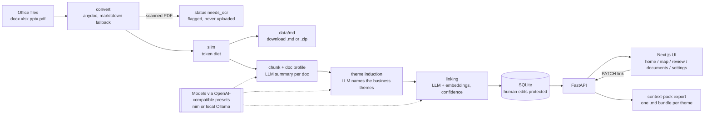
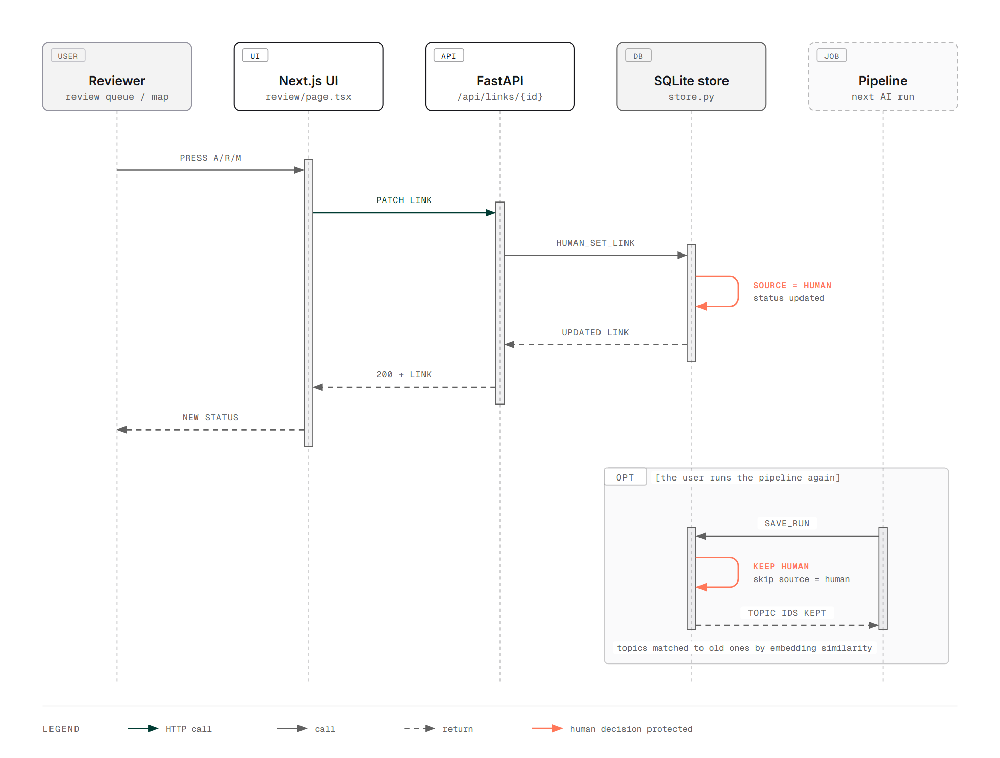

# DocMap architecture

## Data flow

`POST /api/convert` runs only the convert and slim steps, with no model. `POST /api/process` runs the whole flow with the model chosen in Settings (`data/settings.json`). The Markdown from a convert-only run is reused by a later full run.

## One review action

The reviewer presses A, R or M on a link. The UI sends `PATCH /api/links/{id}`, and `store.human_set_link` updates the status and sets `source = human`. When the pipeline runs again, `save_run` skips every link with `source = human` and matches the new topics to the old ones by embedding similarity, so topic ids stay the same. The diagram source is [diagrams/review-action.html](diagrams/review-action.html), and a vector copy is [diagrams/review-action.svg](diagrams/review-action.svg).

## Blind mode (evaluation)

`pipeline --blind` (and `eval --blind`) copies the files to a temp folder under neutral names (`doc-01.pdf` and so on), runs the whole pipeline there, then maps every id back to the original name before saving. No original file name reaches an LLM or embedding prompt, so codes like `fin-` in a name cannot hint at the theme. The holdout corpus is stored already blinded, with the map in `corpus-holdout/blind-map.csv`.

## Progress hook

`run_pipeline(..., on_progress=cb)` calls `cb(stage, done, total)` for the stages `convert`, `chunk`, `embed`, `profile`, `induce` and `save`. The API keeps the latest call, and `GET /api/process/status` returns it with stage times. The home page shows the stages and `done/total`. Converted Markdown is reused only when the file hash, the mode and the converter version match.

## Re-score from reviews

`POST /api/rescore` calls `feedback.rescore`. It uses cached profiles only (no new LLM calls), moves open scores by at most 0.25 and applies a 0.10 penalty near rejected links. It returns suggestions ("the AI now leans to X"), which the review page shows as hints and never applies on its own.

## Settings and downloads

`GET /api/settings` returns the chosen preset, the model names and the folders. `PUT /api/settings` switches between `nim` and `local`. `POST /api/settings/nim-key` saves an NVIDIA key into `backend/.env` and never returns it. `GET /api/settings/check` makes one small embedding call to NIM, or asks Ollama which models are installed. `GET /api/files`, `/api/files/{name}` and `/api/files/all.zip` list and serve the converted Markdown, and `POST /api/open-folder` opens a known folder in Explorer.

## Folders

`backend/docmap/paths.py` finds the repository folder from its own location, so the app runs from any folder. Each folder can also be set with an env var or a CLI flag: `DOCMAP_CORPUS_DIR`, `DOCMAP_MD_DIR`, `DOCMAP_CACHE_DIR` (embedding, LLM answer and token caches), `DOCMAP_SCRATCH_DIR` and `DOCMAP_NOTES_DIR`. The API also reads `DOCMAP_DB`, `DOCMAP_UPLOAD_DIR`, `DOCMAP_EXPORT_DIR` and `DOCMAP_SETTINGS`.

## Writes from the browser

Every write request must carry the header `X-DocMap: 1`. The custom header forces a CORS preflight, so another web page cannot send writes to the local API. Uploads have a size cap and an extension allowlist, file names are cleaned, and the process endpoint only accepts the uploads folder or the sample folder.
